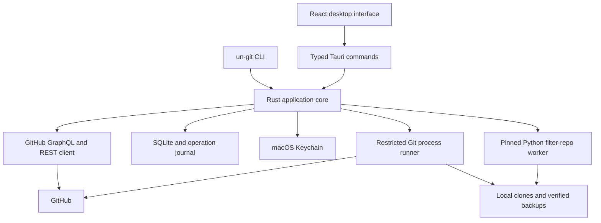

# un-git — product and build plan

Prepared September 27, 2026. Status: proposed implementation plan; no application exists yet.

Confirmed direction: macOS first. Proposed initial distribution: Apple Silicon, signed and notarized DMG; Intel follows after the same packaging tests pass. GitHub.com personal repositories are the initial write target. These scope choices can expand after the first release gates pass.

Selected aesthetic: **Surgical Precision, refined** — graphite surfaces, restrained mineral lime, Geist + Berkeley Mono, and The Disconnect attribution motif. The [design system](DESIGN_SYSTEM.md) defines its implementation; the technical scope, transaction contract, and release gates below remain authoritative.

## 1. Product promise and release strategy

**Help developers understand their GitHub contribution attribution, evaluate removal options, and publish a carefully validated metadata rewrite when appropriate.**

The first useful release should be an inspector. The first engineering milestone should prove the local rewrite engine. This gives the product useful read-only behavior while the dangerous operations receive independent validation.

Success means the user can:

1. Connect GitHub and understand which repositories and identities are visible.
2. Open a contribution day, inspect repositories, and see candidate commits with attribution evidence.
3. Compare manual email detachment with a measured rewrite proposal.
4. Review the exact local result, backup, affected history, and publication risks.
5. Publish once, then separately observe repository correctness and GitHub's calendar response.
6. Recover operation state after interruption and export a diagnostic report.

The product does not promise calendar-event deletion, immediate count reduction, removal of Git objects from forks/caches/PR refs, or erasure of personal information. The first rewrite mode changes attribution metadata while preserving names, files, and dates. It is not a general anonymizer or secret-removal tool.

### Release boundaries

| Release | Included | Remote mutation |
| --- | --- | --- |
| Engine prototype | Synthetic/local scan, selection, impact plan, bundle, candidate rewrite, validation, CLI JSON | None |
| Inspector v0.1 | GitHub connection, current-year calendar, lazy historical years, repository inspection, attribution evidence, advisor, report export | None |
| Cleaner alpha | One eligible personal repository and one default branch per operation; repository/day/SHA selection; local preparation, review, leased publication, recovery, observation | Explicitly reviewed push |
| Cleaner v1 | Hardened alpha scope, signed distribution, complete failure handling and support packet; basic restore workflow | Same constrained write scope |
| Later | Multi-ref and tag support, organizations, broader signed-history policy, LFS, Enterprise, Intel/Windows/Linux expansion | Only after separate gates |

Recovery and diagnostic export are required before the first write-enabled release. They are not V2 extras. A website, hosted repository processing, accounts/billing, cloud database, background daemon, and multi-repository batch cleaning are outside this initial build.

## 2. Corrections and constraints from the research

These are implementation constraints, not reasons to abandon the product.

| Research point | Planning decision and evidence |
| --- | --- |
| A contribution day identifies exact commits | GitHub exposes repository/day aggregates; local history supplies candidate SHAs. Store observed counts separately from inferred attribution. [GraphQL commit contribution types](https://docs.github.com/en/graphql/reference/commits) |
| PKCE is sufficient for a secretless desktop GitHub App | GitHub's authorization-code exchange still requires a client secret. Use GitHub App device flow; device-originated user tokens also support refresh without a client secret. [User token flow](https://docs.github.com/en/apps/creating-github-apps/authenticating-with-a-github-app/generating-a-user-access-token-for-a-github-app), [refresh](https://docs.github.com/en/apps/creating-github-apps/authenticating-with-a-github-app/refreshing-user-access-tokens) |
| Administration permission is unnecessary for full protection checks | Ruleset inspection can use Metadata read, but classic branch-protection inspection requires Administration read. Keep the inspector minimal; require adequate read permissions before publishing. [Rules API](https://docs.github.com/en/rest/repos/rules), [branch protection API](https://docs.github.com/en/rest/branches/branch-protection) |
| A forced REST ref update is compare-and-swap | The REST endpoint does not accept an expected old SHA. Publish through Git using an explicit lease for each target ref. [REST refs](https://docs.github.com/en/rest/git/refs), [git push](https://git-scm.com/docs/git-push) |
| A dry run proves the final result | A dry run is preliminary. Materialize the candidate in a disposable clone, validate it, and publish those exact objects. [git-filter-repo manual](https://github.com/newren/git-filter-repo/blob/main/Documentation/git-filter-repo.txt) |
| Only signatures on selected descendants matter | Export/import behavior can strip signatures and other commit headers throughout the exported scope. Initially reject signed commits, signed tags, and unsupported headers anywhere the worker would export. [git fast-export](https://git-scm.com/docs/git-fast-export), [git-filter-repo limitations](https://github.com/newren/git-filter-repo/blob/main/Documentation/git-filter-repo.txt) |
| Email detachment is safe if selected repositories look clean | Its effects extend across the account. Offer manual guidance with an explicit coverage statement; never claim an incomplete scan proves no collateral effects. GitHub documents historical attribution changes after email removal. [Contribution troubleshooting](https://docs.github.com/en/account-and-profile/how-tos/contribution-settings/troubleshooting-missing-contributions) |
| The graph must settle after 24 hours | Use 24 hours as an observation checkpoint, not a deadline or success guarantee. Repository contributor statistics and profile contribution calendars are different surfaces. [Repository statistics guidance](https://docs.github.com/en/repositories/viewing-activity-and-data-for-your-repository/viewing-a-projects-contributors) |

The pasted research's reports of inflated contribution counts are a failure scenario to accommodate, not verified evidence of GitHub's internal indexing implementation. An unexplained increase must never trigger another rewrite automatically.

## 3. Initial write eligibility

The inspector should work with a broader range of histories than the writer. Unsupported repositories remain useful to inspect.

For alpha, enable publication only when all of these hold:

- The authenticated user owns the personal repository, the app has the required installation access, and effective permissions allow the operation.
- It is a non-fork, non-archived GitHub.com repository with exactly one branch, the default branch, and no tags. `gh-pages` and other branches remain inspection-only initially.
- There are no open PRs or detected PR refs retaining affected history. Any incomplete PR-impact check blocks publication.
- Complete branch protection and active rules checks succeed; any protection/rule the writer cannot safely satisfy blocks publication. The app never changes repository policy.
- The exported object scope contains no signatures, unsupported headers/object formats, LFS pointers, submodules, shallow or partial boundaries, replace refs, grafts, or alternates. These limits may relax after dedicated tests.
- Attribution changes are explicit, confirmed identity matches. Ambiguous identity and committer-only contribution explanations require inspection rather than automatic cleanup.
- The candidate passes all invariants, the backup restores successfully, and the remote state still matches the captured baseline.

Other authors in history do not prove active collaboration. Show the evidence available, disclose that forks and external clones cannot be fully inventoried, and require acknowledgement of collaborator disruption before publication.

Workflow history needs a Phase 0 permissions experiment. Until its behavior is established, a repository with workflow files in the rewrite scope stays read-only. Do not silently request Workflows write or retry a rejected push with broader permissions.

These are product scope limits. There is no general “ignore blockers” switch.

## 4. Architecture and implementation choices

Use **Tauri 2 + React 18 + TypeScript**, Vite, Tailwind, and shadcn/ui, with a **Rust core shared by desktop and CLI**. React 18 follows the workspace conventions; pin a compatible dependency set in the setup milestone. Keep dependency versions in lockfiles and record the rewrite toolchain in every operation.



| Component | Responsibility |
| --- | --- |
| Rust core | Identity evidence, Git DAG scanning, deterministic plans, invariants, operation state, GitHub adapter, recovery |
| CLI | Thin commands over the core; stable JSON output and distinct errors for blocked, invalid, and unknown outcomes |
| Tauri host | Typed command boundary, native dialogs, Keychain integration, progress events; no arbitrary shell API exposed to React |
| React | Calendar, inspector, selection, plan review, operation history; local UI state via Context or Zustand |
| SQLite | Accounts, snapshots, coverage, scan indexes, plans, journal, observations; migrations from the first schema |
| Git subprocess | Raw object/ref access and transport; explicit executable, arguments, environment, timeouts, and output limits |
| Python worker | Fixed reviewed callback consuming a validated selection manifest; no generated executable Python from user input |
| Filesystem | Per-operation immutable manifests, candidate repository, commit map, backup bundle, validation report |

Start with one core crate organized into modules; avoid a crate or service per noun. Use a Rust async runtime for network/process orchestration, serde for typed records, and a SQLite library with explicit transaction support. Select exact crates during scaffolding after compatibility review.

Proposed repository layout, to create during implementation:

```text
apps/desktop/              React UI, src/types, Tauri host and capabilities
crates/un-git-core/        domain, git, github, planner, validator, operations
crates/un-git-cli/         CLI adapter
workers/rewrite/           pinned Python worker and per-project environment
tests/fixtures/            synthetic DAG builders and redacted API fixtures
tests/integration/         real Git transport and interruption tests
docs/                     product plan, decisions, recovery, contributor setup
scripts/                  development, packaging, dependency checks
.github/workflows/         quality checks and signed release build
Cargo.toml                Rust workspace
package.json              frontend workspace scripts
```

No HTTP server is needed between the UI and core. No Supabase or hosted backend is needed for V1.

### Packaging and local storage

Prototype against checked local Git and a project Python environment. For the distributable app, bundle a pinned Git runtime and Python/filter-repo worker so users do not need developer tools. Prove size, helper discovery, signing, licenses, and clean-machine execution in Phase 0; this is a release dependency. Tauri supports architecture-specific external binaries. [Tauri sidecars](https://v2.tauri.app/develop/sidecar/)

Keep app data under the user's Application Support directory. Give each operation its own directory and restrict permissions. Store access/refresh tokens only in Keychain. Backups contain private repository data; show their location and size, retain them through unresolved operations, and allow explicit export/deletion. Deleting a scan cache must not delete its backup.

## 5. Authentication and trust boundaries

Use GitHub App **user access tokens via device flow**. A native client must not contain an app private key or client secret. GitHub recommends avoiding installation-token generation in native applications. [GitHub App best practices](https://docs.github.com/en/apps/creating-github-apps/about-creating-github-apps/best-practices-for-creating-a-github-app)

Onboarding is three distinct steps: authorize the account, install/select repositories, then verify effective capabilities. User access and app installation access intersect; signing in does not grant access to every repository. [Acting for a user](https://docs.github.com/en/apps/creating-github-apps/authenticating-with-a-github-app/authenticating-with-a-github-app-on-behalf-of-a-user)

| Permission | Inspector | Writer |
| --- | --- | --- |
| Account email addresses | Read | Read |
| Repository metadata | Read | Read |
| Contents | Read | Write |
| Pull requests | Read | Read |
| Administration | None; protection status may be incomplete | Read for full classic-protection inspection |
| Workflows | None | None initially; resolve supported cases in the spike |
| Account email changes / repository administration changes | No write access | No write access |

Register a read-only Inspector app first. For alpha, use a separately authorized Writer registration so inspector-only users retain read-only grants. Sharing one registration and upgrading installed permissions is possible later, but an app permission update requires approval from existing installation owners/admins; it is not a per-operation OAuth scope toggle. [Permission updates](https://docs.github.com/en/apps/using-github-apps/approving-updated-permissions-for-a-github-app)

Implementation rules:

- Persist and rotate refresh credentials atomically; serialize refresh between desktop and CLI. Handle expired device codes, slow polling, revoked grants, app uninstall, and Keychain denial.
- Supply Git credentials through a controlled helper/askpass channel backed by Keychain. Never put tokens in URLs, process arguments, SQLite, logs, manifests, or frontend state.
- Use an isolated Git environment: disable inherited hooks, credential helpers, URL rewrites, signing, and external filters; allow only the selected HTTPS GitHub remote. Prefer bare object operations without checkout.
- Treat repository metadata and messages as untrusted text. Do not execute repository scripts or render commit messages as HTML.
- Limit Tauri capabilities and command inputs; validate operation ownership, paths, refs, and plan hashes in Rust. UI button disabling is not authorization. [Tauri security model](https://v2.tauri.app/security/)
- No telemetry or report upload by default. Export a redacted support packet only after preview; never submit a ticket automatically.

## 6. Contribution and attribution model

Maintain three separate records: **what GitHub displayed**, **what Git contains**, and **what the application infers**. Never collapse them into a single “true contribution count.”

Fetch `contributionYears` from `contributionsCollection`; request explicit bounded yearly ranges. Load the current year first and earlier years on demand. Paginate the per-repository day connections; the repository grouping itself is a bounded list, not a cursor connection. Compare returned coverage with aggregate repository counts, subdivide time ranges where helpful, and retain an incomplete flag when completeness cannot be established. Restricted contributions remain visible as unresolved counts where available. [GraphQL user/contribution schema](https://docs.github.com/en/graphql/reference/users)

A day detail should distinguish commits, supported non-commit categories, and restricted/unresolved contributions. Do not force a category breakdown to sum correctly by inventing missing data. GraphQL failures may be partial; record errors and snapshot time alongside surviving data. Respect API rate-limit/reset and retry guidance.

Scan Git objects once, deduplicate by original object ID, and retain:

```text
commit OID, tree OID, ordered parent OIDs
raw author and committer names/emails
author and committer timestamps, including original offsets
raw message bytes/hash, parsed coauthor spans
signature and extended-header indicators
reachability from default branch, gh-pages, and other fetched refs
identity evidence, candidate contribution date, confidence, blockers
```

GitHub documents profile dates based on author dates and commit timestamp time zones, qualifying branch rules, and rebase attribution. Implement date bucketing without converting everything to the viewer's local timezone. Treat committer/rebase credit as an evidence category, not a universal committer-email rule. [Profile contribution reference](https://docs.github.com/en/account-and-profile/reference/profile-contributions-reference)

Collect verified account email evidence and GitHub-resolved identities where available. Preserve raw emails; do not invent Gmail alias normalization or guess ownership from matching names. Handle both known noreply forms as candidates and verify their association. The email endpoint accepts user tokens with Email addresses read. [Email API](https://docs.github.com/en/rest/users/emails)

For the advisor, show measured rewrite scope and coverage of the email scan. Rank methods by actual affected objects/refs and uncertainty. A whole-repository rewrite is not automatically safer than selecting a day. Email detachment is manual, account-wide guidance, including possible impact on wanted contributions and account settings.

### Minimum persistent entities

| Entity | Important fields |
| --- | --- |
| Account / identity | GitHub user ID, login, host, evidence source, Keychain reference, permission snapshot |
| Repository / scan | Stable repository ID, owner/name, default ref, object format, remote URL, scan coverage/time |
| Contribution snapshot | Account, time range, fetched time, daily observations, restricted/partial indicators, API errors |
| Commit / attribution | Raw metadata, parents, tree, reachability, role and identity evidence, confidence |
| Plan | Version, selected OIDs/field edits, baseline ref map, tool versions, scope, blockers, content hash |
| Operation / event | UUID, plan hash, durable state, checkpoint time, candidate refs, publication intent/outcome |
| Backup / validation | Paths, checksums, restored refs, invariant results, complete commit mapping |
| Observation | Operation, observation time, Git ref result, calendar counts, coverage, discrepancy classification |

Store raw messages/object details in operation artifacts when necessary; the database can index hashes and summaries. Plans and artifacts need schema versions for upgrades and recovery.

## 7. Rewrite transaction

The displayed initial impact is a prediction. The final review uses the actual validated candidate and enumerates every changed object and ref.

1. **Inspect and lock locally.** Acquire a per-repository operation lock shared by CLI and desktop. Capture repository identity, branch/rule/access metadata, and all advertised refs; fetch a complete fresh clone. Reconcile fetched tips against the snapshot and restart if they moved during capture.
2. **Freeze the plan.** Resolve repository/day selections to exact original OIDs and explicit field edits. Record tool versions and the original ref map. Repository-wide selection means the matched identities within the supported scope, not every commit indiscriminately.
3. **Back up and prove restoration.** Create a standalone bundle covering fetched Git refs, checksum it, verify it, restore it into an independent repository, and check restored refs/objects. Store relevant GitHub metadata separately. A bundle is not a backup of GitHub issues, settings, hidden refs, LFS storage, or external clones. [git bundle](https://git-scm.com/docs/git-bundle)
4. **Prepare one candidate.** Use a separate fresh clone with independent object storage and a fixed worker. Preserve empty commits, merge topology, message bytes, and original dates. Start with `--prune-empty never`, `--prune-degenerate never`, `--preserve-commit-hashes`, and `--preserve-commit-encoding`; verify their behavior with the pinned toolchain. The hash-preservation option preserves SHA references in messages, not the IDs of changed commits. Reject unsupported input instead of silently normalizing it. [Worker options](https://raw.githubusercontent.com/newren/git-filter-repo/main/Documentation/git-filter-repo.txt)
5. **Validate.** Check the complete before/after mapping and all invariants below. Any unexpected change blocks publication. Preserve the exact candidate objects and target OIDs.
6. **Review.** Display selected versus rewritten commits, ref changes, changed metadata/trailers, automation risks, backup location, and graph uncertainty. Approval binds the completed candidate, plan hash, and validation report. Any modification invalidates approval.
7. **Refresh preflight.** Recheck repository ID, default branch, permissions, rules, refs, and candidate integrity immediately before publication. Abort on drift; never rebuild the candidate silently behind an approval.
8. **Publish.** Persist publication intent before invoking Git. Push only explicit target refs with expected old OIDs. Reconcile the remote even if the command appears to fail.
9. **Observe.** Record whether the target refs now contain the candidate. Separately query contribution data on a backoff schedule while the app is running, and resume overdue observations on next launch.

For each target ref, use explicit `--force-with-lease=<full-ref>:<expected-old-oid>` plus an explicit `<candidate-oid>:<full-ref>` refspec. Require `--atomic` for the planned transport; unsupported atomic publication blocks rather than falling back. No `--mirror`, wildcard refs, unconditional force, or implicit push configuration. [git push semantics](https://git-scm.com/docs/git-push)

Leases protect addressed refs. They do not create a global GitHub repository lock or prevent a new unrelated branch from appearing concurrently. A post-push inventory must detect drift and reduce the certainty of contribution predictions. Later multi-ref support must enforce the same contract for every updated ref.

### Validation invariants

Define commit reachability from the explicitly approved heads, with a separate inventory of observation-only refs. Do not count backup refs, worker bookkeeping, or unreachable objects as additional product history. Keep backups outside the candidate repository. Complete the tool's mapping with proven identity mappings where needed, rather than assuming an omitted entry was unchanged.

| Area | Required result |
| --- | --- |
| Object mapping | Every original reachable commit has one nonzero mapped result; mapping is injective; no missing/extra reachable commits |
| Trees | Identical tree OID for every mapped commit, including all tips |
| Topology | Each new ordered parent list equals the old parent list mapped through the commit map |
| Dates | Raw author/committer timestamps and offsets unchanged |
| Identities | Only selected fields with confirmed ownership change; other names/emails remain byte-equivalent |
| Messages | Only approved coauthor email spans in a parsed terminal trailer block change; other bytes remain identical |
| Change boundary | Independently compute selected commits plus descendants; every commit outside that set retains its exact original OID |
| Ref scope | Exact expected ref set and target map; unaffected refs/objects retain their OIDs |
| Integrity | Git object/connectivity checks pass for baseline, restored backup, and candidate |
| Determinism | Same baseline, toolchain, and plan reproduce identical target OIDs in fixture tests |
| Publication | Observed target refs match the approved candidate; protected concurrent work was never overwritten |

Changing two distinct commits into the same object is a validation failure, even if file contents are identical. Empty commits and merges must not disappear as a side effect. Coauthor parsing must be byte-safe; ambiguous trailers block those edits. Using a reserved placeholder identity is policy configuration recorded in the plan and verified against supported GitHub behavior during the spike.

## 8. Crash recovery, rollback, and calendar verification

Persist state transitions before irreversible steps:

```text
SCANNED → PLANNED → BACKUP_VERIFIED → PREPARING → VALIDATED
        → AWAITING_APPROVAL → READY_TO_PUBLISH → PUBLISHING
        → REFS_VERIFIED → OBSERVING → OBSERVATION_COMPLETE

Side states: BLOCKED, CANCELLED_BEFORE_PUSH, FAILED_LOCAL,
             REMOTE_OUTCOME_UNKNOWN, REMOTE_DRIFT, NEEDS_ATTENTION
```

Startup reconciliation must examine incomplete operations before enabling a new rewrite for that repository. A crash during preparation permits discarding/rebuilding local scratch only when no publish intent exists. A crash or network loss during publication enters `REMOTE_OUTCOME_UNKNOWN`.

Artifact durability is part of the checkpoint contract: flush file contents, atomically finalize artifacts, persist directory changes as appropriate, then commit the journal checkpoint. A database row must never claim `BACKUP_VERIFIED` or `READY_TO_PUBLISH` before its referenced artifacts are durable. Recheck checksums, object availability, and ref manifests on resume before publication or restore. A materialized candidate is immutable after validation.

- Remote equals all expected new tips: record publication as completed and continue observation.
- Remote equals all old tips: retain the exact candidate; a user may explicitly retry publication after a fresh preflight. Do not generate another rewrite.
- Remote is mixed, unexpected, or unreadable: retain the lock on further rewrites and require investigation; never auto-force or auto-rollback.

Cancellation before publication stops local work safely. During publication, the UI must say that the result is being checked; cancelling a process does not prove GitHub rejected its update.

**Rollback is a new reviewed operation.** Restore the previous tip only if the current tip still equals the recorded candidate, using a new explicit lease. If someone has pushed since, block simple rollback and offer recovery instructions. Rollback cannot undo Actions/webhooks/deployments or guarantee reversal of calendar indexing.

Keep two statuses in the UI:

- **Repository:** candidate published and verified / publication unresolved / remote drift.
- **Calendar:** pending / consistent with estimate / increased or otherwise divergent / insufficient visibility.

Do not label a total-count match as proof that particular commits were removed. New activity, changed access, and non-commit events can confound comparisons. Compare affected repository/day observations where available and explain uncertainty.

Use approximate observation checkpoints such as minutes after publication, then an hour and 24 hours, with rate-aware backoff. There is no scheduled OS background agent in V1. After a persistent discrepancy, offer a report containing ref snapshots, mapping evidence, validation results, affected dates, coverage, and timestamps. Redact tokens, messages, source files, and personal emails by default. Treat old/new SHAs and private repository names as previewable optional disclosures.

An unresolved or inflated calendar observation never authorizes a second rewrite. Unlocking future intentional work requires resolving or explicitly closing the prior observation and creating a new independent plan; it must not be presented as a count-repair action.

## 9. Desktop flow

Use a native-feeling utility layout with a sidebar for Calendar, Repositories, Operations, and Settings. Connect appears during onboarding. The calendar is an entry point into inspection; it has no direct destructive button.

Apply [Surgical Precision, refined](DESIGN_SYSTEM.md) across these screens: near-black surfaces, thin dividers, readable metadata, a graphite-to-lime heatmap, and sparse coral outlines for planned attribution edits. Keep observed counts, selected changes, local validation, verified publication, and calendar observation visually distinct. The Disconnect motif illustrates attribution; actual Git diagrams must preserve all commits and parent edges.

| Screen | Primary information and action |
| --- | --- |
| Connect | Account authorization, app installation, selected-repo access, capability checks, local-data explanation |
| Calendar | Year selector, observed heatmap, coverage/freshness, accessible list alternative; click a day |
| Day details | Visible repositories and contribution categories; unresolved counts explained; inspect a repository |
| Repository inspector | Commit table with author date/offset, author/committer/coauthor evidence, reachability, SHA; select repo/day/commits |
| Plan and advisor | Email guidance, selected versus affected counts, blockers, descendant history, estimated calendar effect; prepare locally |
| Review and publish | Actual candidate changes, passed validations, tested backup, exact ref change, final consent |
| Operation details | Durable progress, repository/calendar status, safe cancellation, resume checks, diagnostic export, reviewed restore |
| Settings | Accounts, Keychain state, local storage/backup management, tool versions; no raw token display |

Every screen needs loading, empty, offline, partial-data, revoked-access, and retry states. Progress events come from the core and must survive UI reconnection. Keyboard navigation, visible focus, readable contrast, non-color status labels, and a virtualized large commit table are required.

## 10. Build milestones and acceptance gates

Effort ranges below are planning estimates for one focused developer, excluding account approvals, signing setup delays, and GitHub indexing waits. Re-estimate after Phase 0. Do not expose remote writing to meet a date.

| Phase | Work | Exit evidence | Effort |
| --- | --- | --- | --- |
| 0 — Prove feasibility | Device login/refresh; user-token Git transport; private calendar coverage; classic protections/rules; workflow permissions; filter-repo fidelity; bundled runtime feasibility | Recorded results from disposable fixtures/test repositories; explicit supported-case matrix; no embedded secrets | 4–6 days |
| 1 — Build foundation | Rust/frontend workspace, typed models, process runner, SQLite migrations, operation artifacts, fixture builder, CLI doctor/scan | Synthetic history scans reproducibly; unsafe process inputs rejected; UI can show a real scan | 3–5 days |
| 2 — Prove local transaction | Selection, DAG impact, immutable plans, bundle/restore, worker, complete validator, local interruption recovery | End-to-end local rewrite preserves all invariants across fixture matrix; deliberate corruption is rejected | 7–10 days |
| 3 — Ship inspector | GitHub adapter/auth, identity evidence, pagination/coverage, calendar/day/repository views, advisor and exports | Real read-only workflow plus offline/partial/revoked-access cases; no push path available in inspector build | 5–8 days |
| 4 — Add controlled publication | Writer authorization, eligibility, final review, leases, durable push intent, remote reconciliation, restore, observations | Disposable remote tests pass concurrent pushes, rejection, interrupted acknowledgement, retry, and rollback drift | 7–10 days |
| 5 — Release hardening | Native UX, clean-machine packaging, signing/notarization, dependency/license review, storage cleanup, redacted diagnostics, recovery docs | Signed DMG tested on declared macOS versions; complete restore/recovery drill; no unresolved data-loss defects | 5–8 days |

Total planning range: **31–47 focused engineering days**, roughly **7–10 full-time weeks**, before contingency. Rust/Tauri learning and distribution issues can extend this. Calendar polish and UI mockups can proceed alongside fixture work, but publication depends on the engine and recovery gates.

### Design integration within the existing milestones

| Existing phase | Visual work | Design exit evidence |
| --- | --- | --- |
| 0 — Feasibility | Confirm font distribution requirements and local font loading; record the selected visual direction | Berkeley Mono rights/fallback path documented; no restricted assets embedded prematurely |
| 1 — Foundation | Semantic CSS tokens, Geist/mono typography, shared controls, sidebar, small Disconnect SVG | Basic real scan uses the selected theme with readable text and focus states |
| 2 — Local transaction | Truthful DAG and metadata preview, selected-versus-affected hierarchy, explicit operation state presentation | Motif never deletes a commit; visual states reflect actual local engine results |
| 3 — Inspector | Signature heatmap, accessible day list, coral selection overlay, aligned metadata table | Observed data, partial selection, unknown data, and estimates remain distinct |
| 4 — Publication | Exact-result review, clear publish/restore controls, separate repository/calendar status, recovery states | No premature success styling or hidden blockers; motion follows durable state |
| 5 — Hardening | Native spacing, icon exports, reduced motion, contrast, font fallback and visual consistency | Screen review and accessibility checks pass alongside the existing release gates |

These tasks specify the UI/design work already present in the estimates. Re-estimate if custom font licensing, icon production, or native polish adds material effort; do not trade away correctness or recovery work to fit the original range. A full decorative mockup is not a prerequisite for the engine prototype.

### First implementation batch

1. Record the initial decisions: supported scope, device-flow auth, exact mutation contract, and credential boundary.
2. Scaffold the Rust workspace, thin CLI, and Tauri/React shell with pinned toolchains and minimal quality checks.
3. Add a fixture generator containing an old selected commit, later descendants, a merge, an empty commit, and multiple identities.
4. Implement `doctor`, `scan`, and `plan`; display exact affected objects and blockers as JSON and in a simple inspector.
5. Implement verified bundle restoration and one local candidate rewrite with complete validation.
6. Demonstrate unchanged trees and preserved topology, plus a deliberate invalid rewrite being rejected.

Do not start by building a polished heatmap or wiring a force-push button. The first demo should prove that the engine knows exactly what it changed.

Proposed CLI surface; these commands do not exist yet:

```text
un-git doctor
un-git auth login|logout|status
un-git scan <repository> --json
un-git plan <scan-id> --selection <file> --json
un-git prepare <plan-id>           # backup, local rewrite, validate
un-git inspect-operation <id>
un-git publish <id>               # explicit review of the prepared artifact
un-git verify <id>
un-git export-report <id>
un-git restore-plan <id>
un-git restore <restore-plan-id>  # separately reviewed leased operation
```

## 11. Test and release gates

Use synthetic repositories for exhaustive Git tests and local bare remotes for transport failures. Live tests should use explicitly provisioned disposable repositories, never the developer's real history. Do not assert that GitHub's calendar converges within a deterministic test deadline.

| Suite | Required scenarios |
| --- | --- |
| Git semantics | Root/middle/tip edits, merges and multiple roots, empty commits, same trees, repeated metadata, coauthors, SHA references in messages, unsupported signatures/headers, non-UTF-8 input |
| Identity/date matching | Multiple emails, noreply forms, uncertain aliases, author/committer mismatch, offset midnight, leap days, different machine timezone |
| API behavior | More than one page, bounded repository lists, partial GraphQL data, private/restricted contributions, revoked token, uninstall, permissions changed, rate limits, expired refresh |
| Preservation | Complete injective mapping, ordered parents, tree equality per commit, raw dates, unchanged messages outside approved edits, unrelated refs unchanged |
| Publication | Concurrent target update, unrelated ref creation, protection rejection, atomic rejection, lost response after success, retry of existing candidate, remote rename/default-branch drift |
| Recovery | Crash at each journal boundary, disk full, corrupted/truncated bundle, candidate tampering, duplicate CLI/UI execution, app upgrade with unfinished operation, rollback after new remote work |
| Security | Argument/ref/path injection, malicious messages, inherited Git config/hooks/helpers, token/log/export leakage, Keychain denial, unauthorized Tauri invocation |
| Native/UI | Empty/large/partial calendars, keyboard flows, app quit/reopen, native dialogs, real Keychain, packaged worker paths, clean-machine launch |
| Visual semantics | Palette/contrast, font fallback, reduced motion, focus, partial-selection heatmap, unknown versus zero data, truthful topology, distinct repository/calendar statuses |

Use Rust unit/integration tests for core and real Git fixtures; UI tests for user-visible state transitions. Add browser-based component/flow tests with a mocked IPC adapter, plus a real macOS app smoke suite. Select and validate the native automation route during setup; Tauri documents current WebDriver options. [Tauri testing](https://v2.tauri.app/develop/tests/webdriver/)

Benchmark scan/planning on recorded 1k/10k/100k-commit fixtures before setting supported size limits. Stream raw objects, avoid one subprocess per commit, bound database writes and event volume, and keep the UI responsive during large scans. The writer may enforce a smaller tested limit than the inspector.

Release requires every preservation, concurrent-update, and interrupted-publication test to pass; a restored backup must reproduce the baseline. Publish supported limits and known exclusions. Sign and notarize the complete app including embedded runtimes, and verify distribution on a clean Mac. [macOS distribution signing](https://v2.tauri.app/distribute/sign/macos/)

## 12. Decisions to close during implementation

These do not block planning; they are explicit Phase 0 or release tasks:

- Register Inspector and Writer GitHub Apps and validate device flow, token refresh, HTTPS Git, and private-data visibility for each permission set.
- Establish whether unchanged workflow trees can be republished without Workflows write under the actual user-token setup; keep unsupported cases read-only.
- Prove the pinned export/import pipeline preserves supported raw metadata and topology; narrow scope if it does not.
- Finalize bundled runtime provenance, license obligations, minimum macOS version, and Apple signing access.
- Measure repository size/disk requirements and set enforceable writer limits.
- Resolve Berkeley Mono distribution rights and the permitted bundled fallback before release; implement The Disconnect icon from the selected design system.
- Finalize product name, software license, and distribution page before public release; use `un-git` as the working name and retain the selected visual direction.

If any feasibility gate fails, the inspector can still ship. Remote history rewriting remains unavailable until its corresponding correctness and recovery gates pass.
